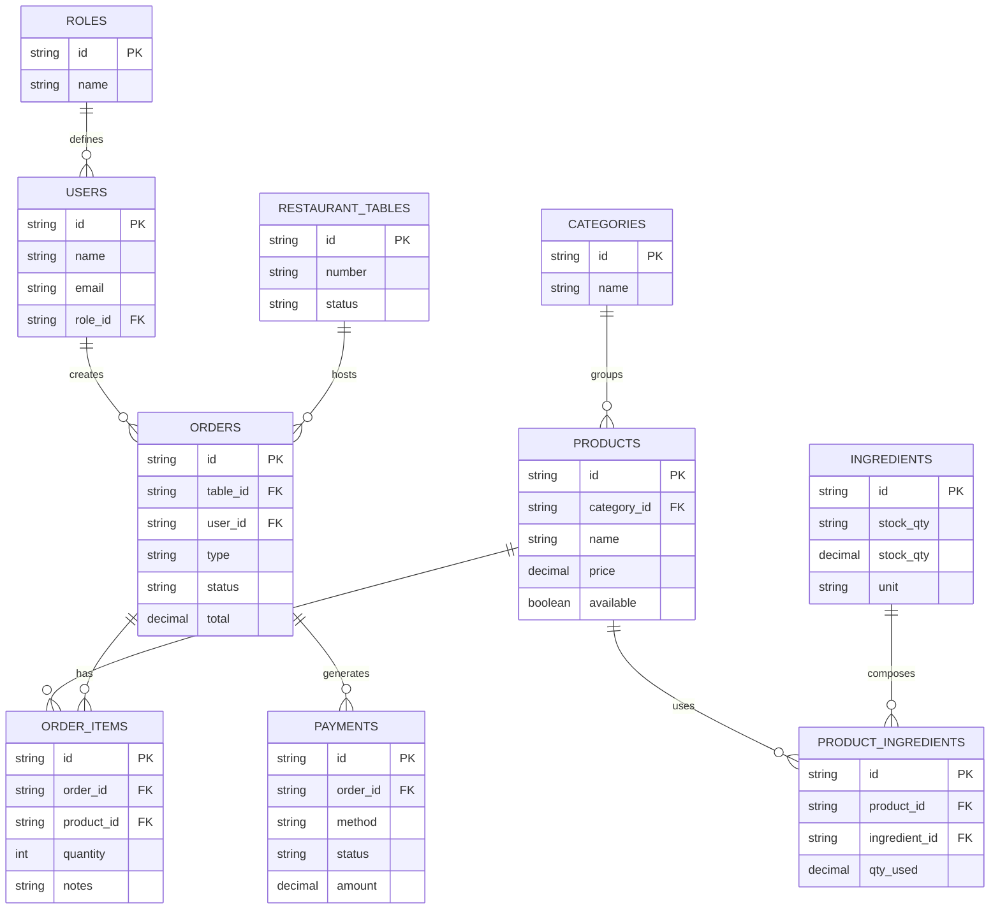

# 🍽️ Restaurant SaaS API & Management System (Elo)

Um sistema completo e escalável de Gestão de Redes de Restaurantes e Pedidos em Tempo Real, construído com **Laravel**, **MySQL**, **Redis** e **Reverb**.

---

## 📐 Diagrama Entidade-Relacionamento (ERD)

Abaixo está a estrutura completa do modelo relacional derivado do `elo_restaurante_erd_v2`:



---

## 🗺️ Roadmap de Desenvolvimento Executivo

Seguiremos rigorosamente a seguinte sequência para a construção do projeto:

1. **🛠️ 1. Setup do Ambiente:**
   Configurar Laravel, Docker (`App`, `MySQL 8`, `Redis`), validar conexões e execução limpa de `migrate` e `db:seed`.
2. **📐 2. Modelagem do Banco (ER Completo):**
   Desenho prévio de todas as tabelas (cardápio, mesas, pedidos, cozinha, estoque, pagamento, usuários/roles) para evitar retrabalho de schema.
3. **🗄️ 3. Migrations e Seeders:**
   Construção de migrations reversíveis (`down`), com foreign keys, e criação de factories/seeders com dados realistas de restaurante.
4. **🔐 4. Autenticação & Papéis (Sanctum + RBAC):**
   Implementação de autenticação via token e papéis (`Dono`, `Gerente`, `Garçom`, `Cozinheiro`, `Caixa`) com Policies para proteção de endpoints.
5. **🍕 5. CRUD do Cardápio:**
   APIs robustas para Categorias, Produtos, Variações e Adicionais com Form Requests e API Resources.
6. **🪑 6. Mesas & Abertura de Comanda:**
   Gestão de status de mesas (`livre`, `ocupada`, `reservada`) e vinculação de comandas ao atendimento do salão.
7. **🛒 7. Pedidos (Máquina de Estados - Coração do Sistema):**
   Criação de pedidos (`salão`, `delivery`, `balcão`) com máquina de estados (`pendente` ➔ `preparo` ➔ `pronto` ➔ `entregue` ➔ `pago`), validações de transição e notificações em tempo real.
8. **📦 8. Estoque Vinculado a Receitas (Ficha Técnica):**
   Cadastro de insumos/ingredientes, consumo por ficha técnica (`qty_used`), baixa automática ao confirmar pedidos e bloqueio por escassez.

---

## 📌 Visão Geral do Projeto

Este projeto foi projetado para atender redes de restaurantes (multi-loja), permitindo o gerenciamento centralizado de marcas/redes, catálogo de produtos por loja, fluxo completo de pedidos com máquina de estados, controle rigoroso de estoque, pagamentos via Webhook e atualizações em tempo real para a cozinha e cliente.

---

## 📋 Checklist de Escopo & Arquitetura

### 1. 🗄️ Modelagem e Banco de Dados
- [ ] **Tabelas Relacionadas (8 a 10+):**
  - `roles` (Papéis/Permissões: Dono, Gerente, Garçom, Cozinheiro, Caixa)
  - `users` (Usuários vinculados a papéis)
  - `categories` (Categorias do cardápio: Entradas, Pratos, Bebidas)
  - `products` (Produtos do cardápio e preços)
  - `ingredients` (Estoque de insumos/ingredientes)
  - `product_ingredients` (Ficha técnica / receita N:N que associa ingrediente a produto)
  - `restaurant_tables` (Mesas do restaurante e seus status)
  - `orders` (Pedidos do salão/delivery/balcão)
  - `order_items` (Itens do pedido + observações)
  - `payments` (Histórico de transações de pagamento)
  - `activity_logs` / `notifications` (Registros polimórficos)
- [ ] **Relacionamentos:**
  - 1:N (`ROLES` ➔ `USERS`, `CATEGORIES` ➔ `PRODUCTS`, `RESTAURANT_TABLES` ➔ `ORDERS`, `USERS` ➔ `ORDERS`, `ORDERS` ➔ `ORDER_ITEMS`, `ORDERS` ➔ `PAYMENTS`)
  - N:N via Pivot (`PRODUCTS` ↔ `INGREDIENTS` através de `PRODUCT_INGREDIENTS`)
  - Polimórfico (`activity_logs` / `notifications` associados a `Order`, `Product`, `User`)
- [ ] **Migrations Versionadas & Reversíveis:**
  - Método `down()` totalmente funcional em todas as migrations.
- [ ] **Seeders & Factories Realistas:**
  - Geração de dados de teste realistas via Factories e Seeders estruturados.

---

### 2. 🔐 Autenticação & Autorização
- [ ] **Autenticação API:** Laravel Sanctum emitindo tokens para SPA / Mobile / Integrações.
- [ ] **Papéis & Permissões (RBAC / Custom):**
  - 👑 **Dono da Rede:** Acesso total a todas as lojas e métricas da rede.
  - 🏬 **Gerente da Loja:** Acesso restrito à sua loja específica (produtos, estoque, relatórios da unidade).
  - 👨‍🍳 **Funcionário / Atendente:** Acesso operacional (visualizar/atualizar pedidos da loja).
- [ ] **Policies Protegendo Recursos:**
  - Isolamento de multi-tenancy / loja através de Policies do Laravel.

---

### 3. 🚀 API RESTful
- [ ] **CRUD Completo:** Padronização REST para recursos principais.
- [ ] **Form Requests:** Validação rigorosa e sanitização dos dados de entrada.
- [ ] **API Resources & Collections:** Formatação customizada das respostas JSON (sem exposição direta de Models).
- [ ] **Filtros, Busca & Paginação:** Implementados nas listagens de grande volume (`/api/v1/products`, `/api/v1/orders`).
- [ ] **Tratamento de Erros Padronizado:**
  - Formato JSON consistente para `404`, `422`, `403`, `500`.
- [ ] **Documentação da API:** Collection exportada do Postman ou Swagger (L5-Swagger / Scramble).

---

### 4. 🧠 Regras de Negócio Reais
- [ ] **Máquina de Estados de Pedidos:**
  - `pendente` ➔ `confirmado` ➔ `preparo` ➔ `pronto` ➔ `entregue` (ou `cancelado`).
  - Validação rigorosa de transições proibidas.
- [ ] **Controle Automático de Estoque:**
  - Baixa automática de ingredientes via Ficha Técnica (`product_ingredients`) ao confirmar o pedido.
  - Bloqueio imediato na criação/confirmação do pedido se o ingrediente estiver esgotado.
- [ ] **Cálculos Financeiros & Lógica Não-Trivial:**
  - Cálculo de subtotal, taxa de entrega dinâmica por distância/bairro e cupons de desconto.

---

### 5. ⚡ Processamento Assíncrono & Queues
- [ ] **Jobs em Fila (Redis / Database):**
  - Job 1: Envio de e-mail/notificação ao alterar status do pedido.
  - Job 2: Processamento/recálculo assíncrono de estoque e geração de relatórios diários.
- [ ] **Tratamento de Failed Jobs:**
  - Estratégia de retries configurada, logging detalhado em falhas e tabela `failed_jobs`.

---

### 6. 🪝 Webhooks de Pagamento
- [ ] **Endpoint Público de Webhook:** Recepção de notificações de pagamento (`/api/v1/webhooks/payments`).
- [ ] **Segurança & Assinatura:** Validação da assinatura HMAC do gateway de pagamento.
- [ ] **Idempotência:** Garantia de que a recepção de webhooks duplicados não processe o pagamento duas vezes (controle por ID de transação).

---

### 7. 📡 Comunicação em Tempo Real (Laravel Reverb)
- [ ] **Broadcasting End-to-End:** Atualizações ao vivo do status de pedidos para a tela da cozinha e painel do cliente.
- [ ] **Canais Privados Protegidos:** `PrivateChannel` exigindo autenticação do usuário/loja no broadcasting.

---

### 8. 🧪 Testes Automatizados
- [ ] **Suíte de Testes de Feature (PHPUnit / Pest):**
  - Fluxo completo de criação de pedido.
  - Processamento e idempotência de webhook de pagamento.
  - Testes de permissões negadas (Policies & RBAC).
- [ ] **Meta de Cobertura:** 15 a 20+ testes focados nos fluxos críticos da aplicação.

---

### 9. 🐳 Infraestrutura & Deploy
- [ ] **Docker & Docker Compose:**
  - Containers para `App (PHP-FPM / Nginx)`, `MySQL 8`, `Redis`, `Reverb`.
- [ ] **Deploy em Produção:**
  - Deploy configurado em nuvem (Railway, Render ou VPS) com HTTPS e domínio/subdomínio.
- [ ] **CI/CD Pipeline:**
  - GitHub Actions executando linters e a suíte de testes a cada `push` e `pull request`.

---

### 10. 📚 Documentação & Mídia
- [ ] **README Completo:** Instruções detalhadas de setup local, variáveis de ambiente e arquitetura.
- [ ] **Diagrama do Banco de Dados:** Modelo ER Mermaid renderizado diretamente no README.
- [ ] **Demonstração Visual:** Prints/GIFs demonstrando a API e o fluxo em tempo real.

---

## 🛠️ Tecnologias Utilizadas

- **Linguagem:** PHP 8.5+
- **Framework:** Laravel 12+
- **Autenticação:** Laravel Sanctum
- **Banco de Dados:** MySQL 8.0
- **Cache & Filas:** Redis
- **Real-Time:** Laravel Reverb
- **Containerização:** Docker & Docker Compose
- **Testes:** PHPUnit / Pest PHP

---

## ⚙️ Como Rodar o Projeto Localmente (Futuro Setup)

```bash
# 1. Clonar o repositório
git clone https://github.com/seu-usuario/elo.git
cd elo

# 2. Copiar arquivo de ambiente
cp .env.example .env

# 3. Subir os containers via Docker
docker-compose up -d --build

# 4. Instalar dependências PHP via Composer
docker-compose exec app composer install

# 5. Gerar chave da aplicação
docker-compose exec app php artisan key:generate

# 6. Rodar as migrations e seeders
docker-compose exec app php artisan migrate --seed

# 7. Executar a fila e o servidor de tempo real (Reverb)
docker-compose exec app php artisan queue:work
docker-compose exec app php artisan reverb:start
```

---

## 📄 Licença

Este projeto é um software de código aberto sob a licença [MIT](LICENSE).
