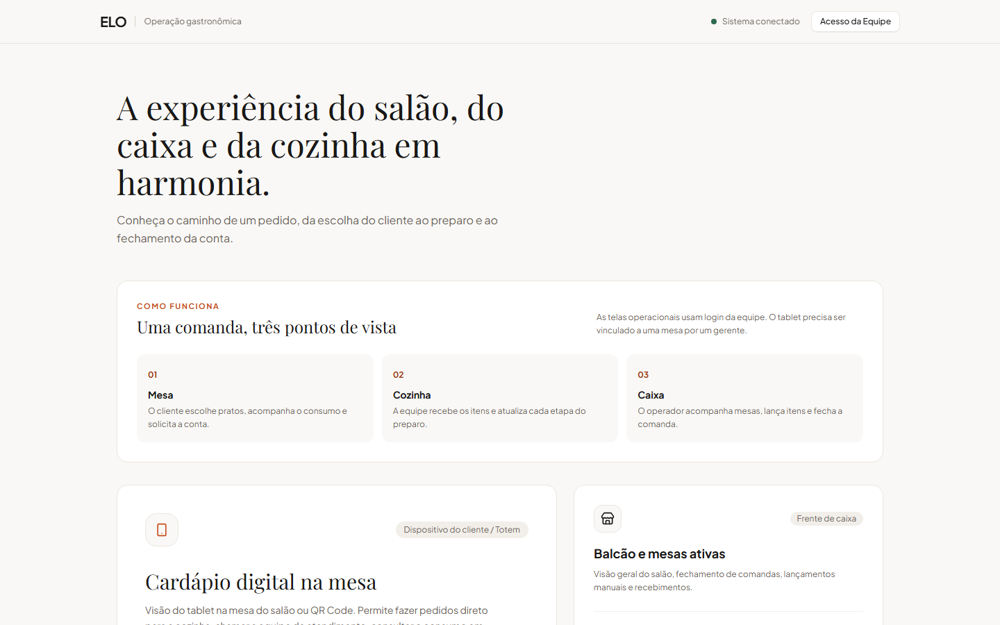

# ELO Gastronomia

O ELO é um protótipo funcional de operação para restaurantes. Ele reúne a experiência do cliente na mesa, a fila de preparo da cozinha, o atendimento no caixa e a gestão de cardápio e estoque em um único fluxo.

O projeto foi criado para demonstrar regras de negócio e integração entre interfaces: um pedido feito no tablet aparece na cozinha, avança por etapas de preparo e integra a comanda acompanhada pelo caixa. É um projeto em evolução, ainda não preparado para operar com pagamentos reais ou dados de clientes em produção.



Leia também a [apresentação do Elo](docs/apresentacao-elo.md), com a ideia por trás do projeto, as tecnologias usadas e os aprendizados que motivaram sua criação.

## Conheça o fluxo

| Etapa | Interface | O que acontece |
| --- | --- | --- |
| 1. Mesa | `/table` e `/table/{mesa}` | Um gerente vincula o tablet; o cliente inicia o atendimento, consulta o cardápio, faz pedidos e solicita a conta. |
| 2. Cozinha | `/kitchen` | A equipe acompanha os itens e atualiza o preparo. A baixa de ingredientes ocorre quando o item entra em preparo. |
| 3. Caixa | `/counter` | O operador acompanha as mesas, lança itens, atende chamados e fecha a comanda. |
| 4. Gestão | `/menu` e `/superadmin` | A gerência mantém produtos, categorias e ingredientes; o administrador da plataforma gerencia restaurantes. |

As telas operacionais exigem autenticação e papel adequado. O tablet precisa ser vinculado a uma mesa com credenciais de gerente. A página inicial explica o fluxo para quem visita o projeto sem uma conta.

## O que está implementado

- API REST versionada com autenticação Sanctum e papéis de administrador, gerência, garçom, cozinha e caixa.
- Restaurantes com dados separados por `restaurant_id`, incluindo cardápio, mesas e pedidos.
- Pedidos e comanda por mesa, estados de preparo por item e controle de estoque por ficha técnica.
- Interfaces para cliente, cozinha, caixa, gestão de cardápio e administração da plataforma.
- Atualização periódica das telas operacionais por consulta à API. O backend também emite eventos de status; a interface atual não depende de uma conexão WebSocket para funcionar.
- Integração opcional com Stripe para cartão, com criação de PaymentIntent, confirmação e webhook assinado. Sem chaves de teste, essa opção não fica disponível na interface.

## Stack

- Backend: PHP 8.5, Laravel 13, Sanctum, PHPUnit e MySQL.
- Frontend: Next.js 16, React 19, TypeScript e Tailwind CSS 4.
- Testes de interface: Playwright e axe-core.

As versões instaladas podem ser conferidas em `composer.lock` e `frontend/package-lock.json`.

## Rodar localmente

Pré-requisitos: PHP compatível com as dependências do Composer (8.4.1 ou superior), Composer, MySQL, Node.js e npm. O ambiente usado no desenvolvimento roda PHP 8.5.1, backend na porta `8001` e frontend na porta `3000`.

1. Instale as dependências PHP e copie `.env.example` para `.env`. Configure `DB_CONNECTION=mysql`, `DB_HOST`, `DB_PORT`, `DB_DATABASE`, `DB_USERNAME` e `DB_PASSWORD` para um banco **local separado**. Ajuste `APP_URL=http://localhost:8001`.
2. Gere a chave e prepare o banco:

   ```bash
   composer install
   php artisan key:generate
   php artisan migrate
   php artisan db:seed
   ```

3. Inicie a API:

   ```bash
   php artisan serve --port=8001
   ```

4. No diretório `frontend`, instale as dependências e crie `.env.local` com `ELO_API_ORIGIN=http://127.0.0.1:8001`. Depois inicie o frontend:

   ```bash
   cd frontend
   npm ci
   npm run dev
   ```

5. Abra `http://localhost:3000`. A API usa o prefixo `/api/v1`.

O seeder gera uma senha para o super administrador e cria contas operacionais de exemplo. Confira a saída do seeder e altere as senhas antes de expor qualquer instância. Não execute `migrate:fresh` em um banco que contenha dados que você queira preservar.

### Configurações opcionais

Para testar cartão, configure `STRIPE_SECRET_KEY` e `STRIPE_WEBHOOK_SECRET` no backend e `NEXT_PUBLIC_STRIPE_PUBLISHABLE_KEY` no frontend, usando somente chaves de teste. `NEXT_PUBLIC_WIFI_NAME` e `NEXT_PUBLIC_WIFI_PASSWORD` exibem a ação de Wi-Fi no tablet. O envio de e-mail depende da configuração do provedor no backend.

## Testes

Os testes PHP usam o banco `elo_testing`, definido em `phpunit.xml`. Crie e configure esse banco antes de executar a suíte; ele deve ser separado do banco de demonstração.

```bash
php artisan test --compact
cd frontend
npm run lint
npm run build
npx playwright test
```

Os testes de navegador exigem frontend e API de teste em execução e um navegador Playwright instalado. Veja `frontend/README.md` para as variáveis do fluxo integrado.

O workflow de CI executa a suíte PHP e o lint e build do frontend em pushes e pull requests. Nos pull requests, também roda os testes de navegador e acessibilidade que usam respostas simuladas. A jornada integrada entre mesa, cozinha e caixa continua exigindo um ambiente de teste exclusivo e as variáveis descritas no README do frontend.

## Estado e limites

O fluxo principal funciona como demonstração técnica. Antes de disponibilizar uma instância pública, ainda é necessário revisar credenciais de exemplo, configuração de e-mail e Stripe, observabilidade e processo de implantação. As rotas públicas de mesa usam um número previsível e ainda não exigem uma credencial individual da sessão para pedidos, chamados e consulta da comanda; esse fluxo precisa de autorização própria antes de ser exposto como serviço real. Ingredientes já baixados no início do preparo não voltam automaticamente ao estoque quando um pedido é cancelado ou uma mesa é liberada; isso precisa de uma regra operacional definida para desperdício e estorno.

O [relatório de QA](docs/relatorio-qa-hardening.md) registra a revisão anterior e seu contexto de testes. As correções posteriores devem ser avaliadas pelos testes e pelo histórico do repositório.
